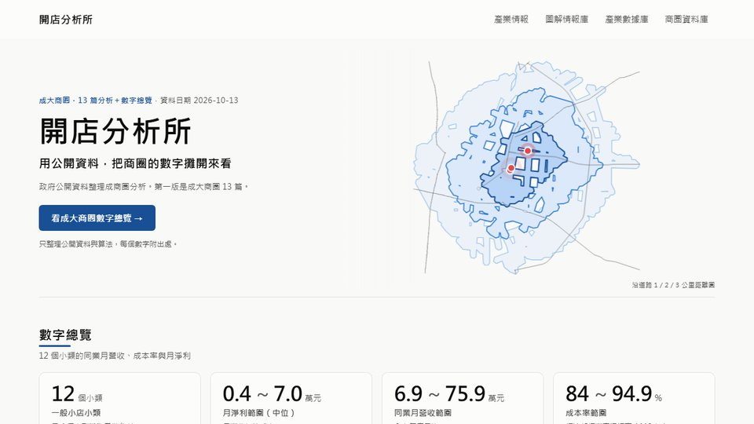
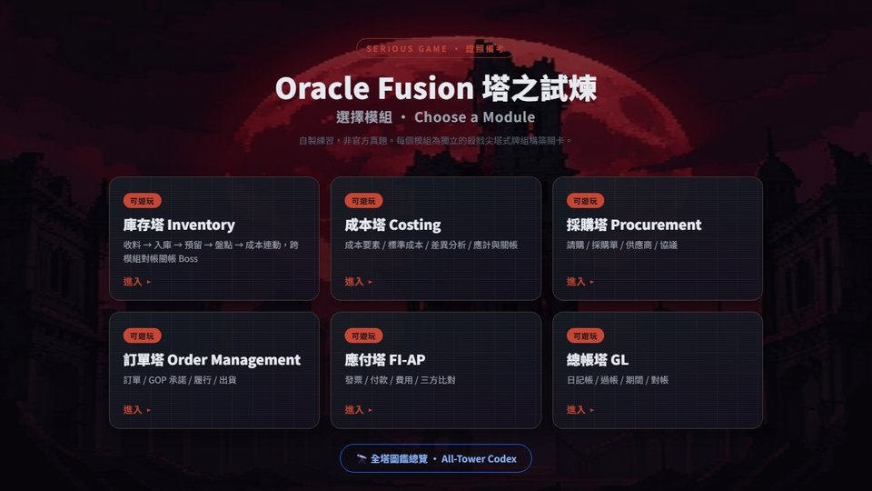
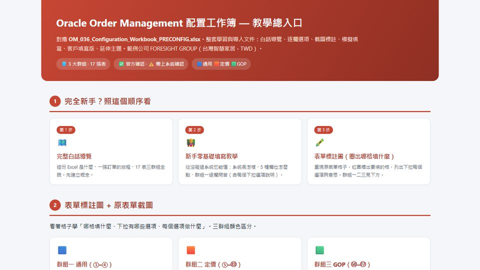

# Hi, I'm JasonLee

**Tech Management × AI Engineering × Cross-Border Operations**

把 MBA 的「策略語言」翻成工程師聽得懂的 prompt，把 AI 工具翻成主管聽得懂的決策。

  

---

## About

資料分析師 · 清華大學科技管理研究所 · 前日本愛知地區營運主管，曾統籌跨國百人團隊 · 2025年正式進入 AI engineering，從 prompt → skill → 自動化管線一路自學自做。

相信「**翻譯員**」這個角色：在技術與管理之間，把雙方的語言翻成對方聽得懂的版本。Repos 是這個信念的副產品。

---

## Projects

<table>
<tr>
<td width="50%" valign="top">

<h3>開店分析所</h3>
用政府公開資料做成大商圈開店評估：互動圖表、各篇分析與 CSV 下載。
  
<a href="https://lee-unhn.github.io/industry-insight-site/"><b>線上瀏覽</b></a> · <a href="https://github.com/Lee-unhn/industry-insight-site">原始碼</a>
</td>
<td width="50%" valign="top">

<h3>Oracle Fusion 塔之試煉</h3>
把 ERP 證照備考做成牌組構築 Roguelike，六座塔對應六個模組，純前端離線單檔。
  
<a href="https://lee-unhn.github.io/erp-tower/"><b>線上遊玩</b></a> · <a href="https://github.com/Lee-unhn/erp-tower">原始碼</a>
</td>
</tr>
<tr>
<td width="50%" valign="top">

<h3>Oracle OM 配置工作簿教學包</h3>
17 張設定表的白話導覽、逐欄選項、表單標註圖與連動關係。
  
<a href="https://lee-unhn.github.io/oracle-om-config-guide/"><b>線上瀏覽</b></a> · <a href="https://github.com/Lee-unhn/oracle-om-config-guide">原始碼</a>
</td>
<td width="50%" valign="top">

<h3>AutoVtuber</h3>
填一張表單，約 8 分鐘產出可直接載入 VSeeFace 的 .vrm 模型。SDXL + TripoSR。
  
<a href="https://github.com/Lee-unhn/AutoVtuber"><b>原始碼</b></a> · 本機執行
</td>
</tr>
<tr>
<td colspan="2" valign="top">
<h3>video-to-podcast-toolkit</h3>
訪談影片 → podcast 一集的全套素材：m4a、三版海報、Reel、文案。本機 FastAPI Web UI，拖檔即跑。
  
<a href="https://github.com/Lee-unhn/video-to-podcast-toolkit"><b>原始碼</b></a> · 本機執行
</td>
</tr>
</table>

---

## Stack I work with

**Daily**: Python · TypeScript / React · Claude Code · Ollama (local LLM) · Gemini API · FastAPI · Vite

**Comfortable**: n8n · MySQL · MediaPipe · Whisper · Edge TTS · GitHub Actions · Cloudflare Pages · FB Graph API

**Learning**: Tauri · CRDT (Yjs) · 矽光子 / 量子應用脈絡

---

## Background

- **學歷** · 國立清華大學 科技管理研究所 碩士
- **教學** · 清華大學聘任講師 · 跨文化決策模型 / 數據驅動管理實務
- **語言** · 日文 JLPT N1 · 英文 TOEIC 商務級 · 德文 ZDaF B2
- **跨國營運** · 日本愛知地區多門市區域主管 · 帶領團隊達成年營收 20–30% 成長
- **精實人資** · 優化新人培訓與升遷制度，縮短 15% 導入週期、提升 13% 人員穩定率

---

## Contact

 

> 想聊技術轉譯、跨國團隊、AI 落地，或單純想看一個 MBA 怎麼學 vibe coding —— 都歡迎寫信。
